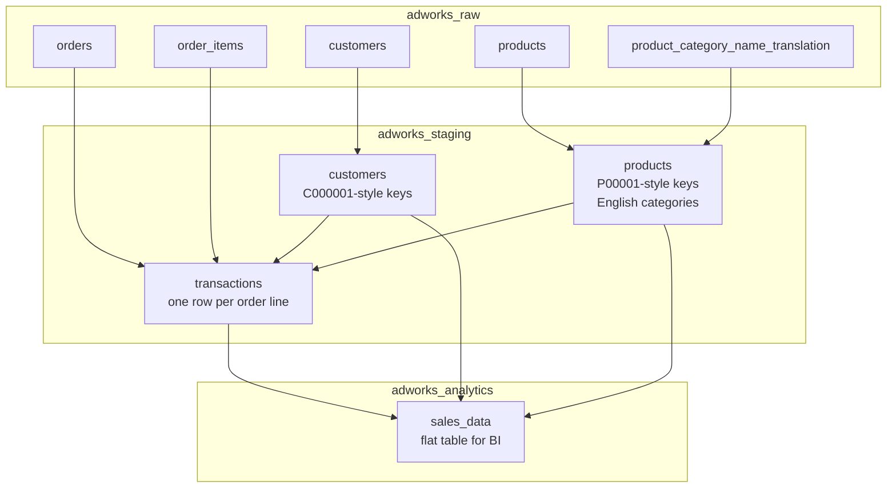

# 🛒 Olist E-Commerce Analytics: From Raw CSVs to Executive Dashboard

> **End-to-end analytics project** that turns 9 messy Brazilian e-commerce CSV files into a clean, query-ready MySQL warehouse and a 2-page Power BI dashboard covering revenue, customers, product categories and delivery performance.


---

| | |
|---|---|
| **Problem** | A marketplace has raw, multi-table order data but no single trusted view of sales, customers and delivery performance. |
| **What I built** | An automated **ETL pipeline** (Python → MySQL), a **raw → staging → analytics** SQL warehouse, and an **interactive Power BI report**. |
| **Skills shown** | Data extraction and loading, SQL data cleaning and modeling, window functions, data profiling, KPI design in DAX, dashboard storytelling. |
| **Dataset** | [Olist Brazilian E-Commerce](https://www.kaggle.com/datasets/olistbr/brazilian-ecommerce) (about 100k orders, 2016 to 2018) |

---

## 🔄 Workflow

```mermaid
flowchart LR
    A[("Kaggle<br/>Olist dataset<br/>9 CSV files")]
    B["Python<br/>kagglehub, pandas,<br/>SQLAlchemy"]
    C[("MySQL<br/>adworks_raw<br/>untouched copy")]
    D[("MySQL<br/>adworks_staging<br/>cleaned and keyed")]
    E[("MySQL<br/>adworks_analytics<br/>sales_data")]
    F["Power BI<br/>data model and DAX"]
    G["Dashboard<br/>Overview and<br/>Marketplace Performance"]

    A -->|download| B
    B -->|to_sql| C
    C -->|clean, standardize,<br/>generate keys| D
    D -->|join and filter,<br/>derive metrics| E
    E -->|import| F
    F -->|visualize| G

    style A fill:#e8f0fe,stroke:#4a6fa5,color:#111
    style B fill:#fff4d6,stroke:#c9a227,color:#111
    style C fill:#fde8e8,stroke:#c0504d,color:#111
    style D fill:#fdf0e0,stroke:#d9822b,color:#111
    style E fill:#e6f4ea,stroke:#3c8d5a,color:#111
    style F fill:#f3e8fd,stroke:#8e5bb5,color:#111
    style G fill:#f3e8fd,stroke:#8e5bb5,color:#111
```



### How the staging layer connects



---

## 🧭 Business Questions Answered

- 💰 How much revenue are we generating, and how does it trend month by month?
- 👥 How many unique customers do we serve, and what is the average order value?
- 📦 Which product categories and cities drive the most revenue?
- 🚚 Are we delivering on time, and which states struggle most?

---

## 🧱 What Each Layer Does

| Layer | Tool | What happens |
|---|---|---|
| **1. Extract and Load** | Python (`olist.ipynb`) | Downloads the dataset with `kagglehub`, normalizes table names, and loads every CSV into MySQL using `pandas.to_sql`. Credentials are read from a `.env` file, never hardcoded. |
| **2. Staging (clean)** | SQL (`olist_cleaning.sql`) | Replaces 32-character IDs with readable surrogate keys, translates Portuguese categories to English, fills missing categories as `uncategorized`, trims and standardizes city and state text, casts text to `DATETIME`. |
| **3. Transactions** | SQL | Joins orders, order items, customers and products into one structured fact table with order, delivery and estimated dates, price and freight. |
| **4. Analytics** | SQL | Builds a flat `sales_data` table with delivery delay days, quantity and revenue, filtered to valid rows (no null keys, price above 0). |
| **5. Visualize** | Power BI | Star-style model with a Calendar table, DAX measures and two report pages. |

### SQL techniques used
`ROW_NUMBER()` and `DENSE_RANK()` window functions · `CTAS` (create table as select) · `LEFT` / `INNER JOIN` · `COALESCE` / `NULLIF` · `CASE` logic · string cleaning (`TRIM`, `LOWER`, `UPPER`, `LPAD`) · date functions (`DATEDIFF`, `DATE_FORMAT`) · profiling queries for NULL and duplicate checks

---

## 📊 Dashboard

| Page 1: Overview | Page 2: Marketplace Performance |
|---|---|
|  |  |

**Page 1: Overview**
- KPI cards: Net Revenue, Total Orders, Unique Customers, Avg Monthly Revenue
- Revenue trend over time (area chart)
- Top product categories and top cities by revenue
- On-Time Delivery % gauge
- Year and month slicer

**Page 2: Marketplace Performance**
- KPI cards: Avg Order Value, Units per Order, Avg Delivery Delay (days)
- On-Time Delivery % by customer state
- Category performance bubble chart (bubble size = total orders)
- Monthly orders and revenue combo chart
- Year and month slicer

### 📐 Key DAX measures
`Net Revenue` · `Total Orders` · `Unique Customers` · `Avg Monthly Revenue` · `Avg Order Value` · `Units per Order` · `On-Time Delivery %`

---

## 💡 Key Insights

> ✏️ *Replace these with your own findings. Recruiters love a clear "so what".*

1. **Revenue:** ______ (e.g. "Revenue grew X% between 2017 and 2018, peaking in November.")
2. **Categories:** ______ (e.g. "Top 5 categories generate X% of revenue.")
3. **Geography:** ______ (e.g. "São Paulo state leads revenue, but state Y has the weakest on-time rate.")
4. **Delivery:** ______ (e.g. "X% of orders arrive on or before the estimated date.")

---

## 🗂️ Repository Structure

```
olist-ecommerce-analytics/
├── notebooks/
│   └── olist.ipynb              # Extract and load: Kaggle → MySQL (raw)
├── sql/
│   └── olist_cleaning.sql       # Staging and analytics layers
├── dashboard/
│   └── olist_ecommerce.pbix     # Power BI report
├── images/                      # Dashboard screenshots
├── .env.example                 # Template for DB credentials
└── README.md
```

---


## 🧪 Data Quality and Design Decisions

- **Surrogate keys** (`C000001`, `P00001`, `O000001`) replace long hash IDs so tables are easier to read and join.
- **Uncategorized fallback** keeps products with missing categories in the analysis instead of dropping them.
- **Revenue** is defined as item price (freight is tracked separately in staging).
- **Delivery delay** = delivered date minus estimated date (negative means early).
- **Raw layer is never modified**, so every transformation is repeatable and auditable.

---

## 🔭 Next Steps

- [ ] Add `order_payments` and `order_reviews` for payment-mix and customer-satisfaction analysis
- [ ] Add seller-level performance
- [ ] Customer segmentation (RFM) and repeat-purchase analysis
- [ ] Schedule the pipeline (Airflow or cron) for automated refresh

---

*If this project was useful or interesting, a ⭐ on the repo is appreciated!*
