# Olist-E-Commerce-Analytics
# 🛒 Olist E-Commerce Analytics: From Raw CSVs to Executive Dashboard

> **End-to-end analytics project** that transforms 9 messy Brazilian e-commerce CSV files into a clean, query-ready **3-layer MySQL warehouse** (`raw -> staging -> analytics`) and a **2-page Power BI dashboard** uncovering revenue growth, customer buying habits, and delivery bottlenecks.


---

## 👀 TL;DR for Recruiters

| | |
|---|---|
| **Problem** | A marketplace has 112K+ rows of raw, multi-table order data but no single trusted view of sales growth, customer retention, and regional delivery delays. |
| **What I built** | An automated **ETL pipeline** (Python -> MySQL), a **raw -> staging -> analytics** SQL warehouse, and an **interactive 2-page Power BI report**. |
| **Skills shown** | ETL automation, SQL surrogate key modeling (`ROW_NUMBER`, `DENSE_RANK`), data quality auditing, DAX KPI design, and executive storytelling. |
| **Dataset** | [Olist Brazilian E-Commerce](https://kaggle.com) (98K+ valid delivered orders across 112K item lines, Sept 2016 – Aug 2018) |

---

## 🔄 End-to-End Architecture

```mermaid
flowchart LR
    A[("Kaggle<br/>Olist dataset<br/>9 CSV files")]
    B["Python<br/>kagglehub, pandas,<br/>SQLAlchemy"]
    C[("MySQL<br/>adworks_raw<br/>untouched copy")]
    D[("MySQL<br/>adworks_staging<br/>cleaned and keyed")]
    E[("MySQL<br/>adworks_analytics<br/>sales_data")]
    F["Power BI<br/>data model and DAX"]
    G["Dashboard<br/>Overview & Marketplace<br/>Performance"]

    A -->|download| B
    B -->|to_sql| C
    C -->|clean, standardize,<br/>generate keys| D
    D -->|join and filter,<br/>derive metrics| E
    E -->|import| F
    F -->|visualize| G

    style A fill:#e8f0fe,stroke:#4a6fa5,color:#111
    style B fill:#fff4d6,stroke:#c9a227,color:#111
    style C fill:#fde8e8,stroke:#c0504d,color:#111
    style D fill:#fdf0e0,stroke:#d9822b,color:#111
    style E fill:#e6f4ea,stroke:#3c8d5a,color:#111
    style F fill:#f3e8fd,stroke:#8e5bb5,color:#111
    style G fill:#f3e8fd,stroke:#8e5bb5,color:#111
```



---

## 📊 Dashboard Preview

> 📸 *Save your two dashboard screenshots inside `/images` as `overview.png` and `marketplace_performance.png`.*

| Page 1: Executive Overview | Page 2: Marketplace & Delivery Performance |
|---|---|
|  |  |

---

## Business Questions Answered & How I Solved Them

### 1. 💰 How is revenue growing, and is the trend reliable?
* **What I found:** Net revenue hit **R\$ 13.50M** across **98K valid orders**, surging to an all-time peak in **November 2017 (Black Friday)** and sustaining with average of **R\$ 909K/month** through August 2018—beating full-year 2017 in just 8 months.
* **How I solved it:** Identified that **September 2018** contained only 1 order (a dataset cutoff artifact) and 2016 had only 3 partial launch months. Filtered out September 2018 in Power BI so monthly averages shows actual performance without fake drops.

### 2. 👥 Are customers coming back, and how many items they usually purchased?
* **What I found:** Out of **95K unique customers**, roughly **97% placed only one order**, and shoppers averaged **1.14 units per order** (**R\$ 137.43** Average Order Value).
* **How I solved it:** Separated `order_key` (unique checkouts) from `quantity` (individual item lines) in SQL and DAX (`DISTINCTCOUNT` vs. `SUM`) to prove Olist's growth relied almost entirely on new single-item buyers rather than repeat loyalty.

### 3. 🚚 Why do orders arrive late, and which areas slow down shipping?
* **What I found:** Overall on-time delivery hit **93%**, arriving an average of **12.03 days early** (`-12.03` variance). However, whenever monthly orders jumped past **7,000** (Nov 2017 & Feb–Mar 2018), on-time delivery dropped to **~80%–85%**. Based on region, distant northern states (**Pará / PA**) and high-volume Southeast hubs (**Rio de Janeiro / RJ**, **Espírito Santo / ES**) suffered the lowest on-time rates, regardless of item price.
* **How I solved it:** Engineered `DATEDIFF(delivered_date, estimated_date)` in SQL, then built a monthly volume-vs.-SLA combo chart, a price-vs.-delay scatter plot, and a Bottom 10 States ranking in Power BI.

---

## How Business Owner Can Take Actions

* **Split Busy Delivery Districts & Add Local Couriers:** Partner with extra local delivery services in high-delay states (**RJ**, **ES**, **PA**) and break busy districts into smaller delivery batches so drivers aren't overloaded during sales rushes.
* **Increase Basket Size (`1.14` -> `1.30+` Units/Order):** Introduce bundle deals or free-shipping thresholds above **R\$ 150** to encourage multi-item checkouts.
* **Turn One-Time Buyers into Repeat Shoppers:** Trigger automated thank-you discount vouchers right after early deliveries to boost customer retention.
* **Keep Safe Delivery Windows:** Maintain conservative shipping estimates that allow Olist to delight shoppers by arriving **12 days early** on average.

---

## 🧱 Warehouse & Pipeline Architecture

| Layer | Tool | What Happens |
|---|---|---|
| **1. Extract & Load** | Python (`olist.ipynb`) | Downloads the Kaggle dataset via `kagglehub`, normalizes table names, and loads all 9 CSVs into `adworks_raw` using `SQLAlchemy` + `.env` security. |
| **2. Staging (Clean)** | SQL (`olist_cleaning.sql`) | Replaces 32-character hash IDs with readable surrogate keys (`C000001`, `P00001`, `O000001`), maps Portuguese categories to English (`COALESCE` fallback to `uncategorized`), and standardizes city/state text. |
| **3. Analytics Mart** | SQL (`adworks_analytics.sales_data`) | Joins staging tables into a clean denormalized fact table, calculates `delivery_delay_days`, and filters out invalid/zero-price rows. |
| **4. BI & DAX** | Power BI (`olist_ecommerce.pbix`) | Connects `sales_data` to a **Calendar** table and computes `Net Revenue` and `Total Orders` (excluding `canceled` and `unavailable` statuses). |

---

## 🗂️ Repository Structure

```text
Online-Retail-End-to-End-Analytics-Project/
├── notebooks/
│   └── olist.ipynb                  # Automated Kaggle -> MySQL raw ingestion
├── sql/
│   └── olist_cleaning.sql           # Raw -> Staging -> Analytics transformations
├── dashboard/
│   └── olist_ecommerce.pbix         # 2-page Power BI report file
├── images/
│   ├── overview.png                 # Page 1: Executive Overview screenshot
│   └── marketplace_performance.png  # Page 2: Marketplace Performance screenshot
├── .env.example                     # Template for MySQL credentials
└── README.md                        # Project documentation, findings, and solutions
```

